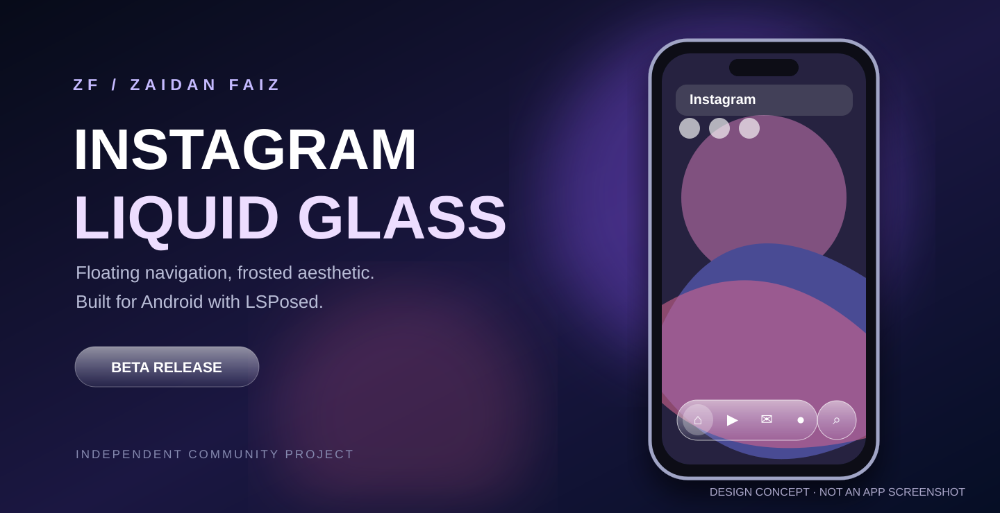
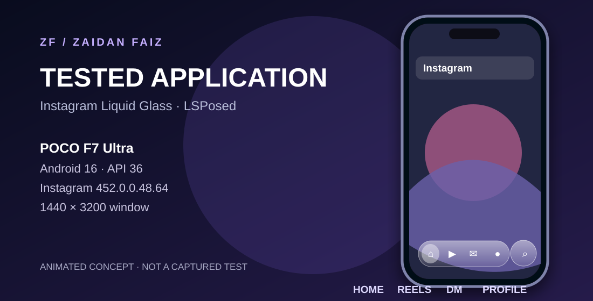

<div align="center">

# Instagram Liquid Glass

**A floating, frosted-glass navigation experience for Instagram on Android.**

An independent LSPosed module — no modified Instagram APK required.
<p align="center">
  
</p>


[](https://github.com/zaidanfaiz/Instagram-LiquidGlass-LSPosed/actions/workflows/build-apk.yml)
[](https://github.com/zaidanfaiz/Instagram-LiquidGlass-LSPosed/releases/tag/v0.1.0-beta.1)


**[Download](https://github.com/zaidanfaiz/Instagram-LiquidGlass-LSPosed/releases/tag/v0.1.0-beta.1) · [Preview](#live-preview) · [Installation](#installation) · [Compatibility](#compatibility) · [Report a bug](https://github.com/zaidanfaiz/Instagram-LiquidGlass-LSPosed/issues/new/choose)**

**English** · [Bahasa Indonesia](README_ID.md)

</div>

---

## A fresh take on Instagram navigation

**Home → Reels → DM → Profile → Search**

A rounded glass capsule for Home, Reels, DM and Profile, with a separate floating Search control. Instagram's original app and tab actions stay in place.

<div align="center">

<sub>Concept artwork — not an actual application screenshot.</sub>
</div>

### Highlights

| Experience | What it does |
| :--- | :--- |
| **Floating Liquid-Glass-inspired UI** | Rounded transparent capsules, reflective edges, animated selected lens and background blur |
| **Frosted Reels** | Experimental video-aware blur via limited asynchronous Android `PixelCopy` sampling |
| **Five destinations** | Home, Reels, Direct inbox, your profile and a standalone Search button |
| **Swipe navigation** | Glass-bar gestures plus best-effort remapping of Instagram's native horizontal page swipes |
| **Context-aware overlay** | Designed to hide when viewing Stories, Reels comments, opened DM chats or other users' profiles |
| **Native Instagram retained** | Runs through LSPosed on the installed Instagram app; no repackaged Instagram APK |

> [!NOTE]
> This is a **beta**, not Apple's native iOS Liquid Glass compositor. Rendering uses sampled/blurred Android content; some videos may temporarily show clear glass if sampling fails. Content-area swipe remapping can briefly pass through Instagram's native tab order.

## Live preview

<div align="center">


**Illustrative animation** — this moving phone and navigation lens are a design mockup, not captured app footage.
</div>

### Real screenshots

Actual Home, Reels, DM, Profile and Search captures can be added under `assets/readme/screenshots/`. See the [asset guide](assets/readme/README.md). Real footage is not currently provided; no simulated visuals are presented as tested results.

## Compatibility

**This module is not locked to one Instagram or Android version.** It hooks the installed `com.instagram.android` application and looks for navigation views. Other versions **may work**, but layout differences can affect fullscreen spacing, blur or gestures.

| Requirement | Details |
| :--- | :--- |
| **Android** | Android 10+ (APK `minSdk 29`); feature compatibility depends on Android and ROM |
| **Instagram** | Installed official `com.instagram.android` application |
| **Framework** | Working LSPosed environment, scoped to Instagram |
| **Device** | Root or another supported environment capable of using LSPosed |
| **Other app/OS builds** | Welcome to test; not all configurations have been verified |

### Verified development test device


**Note:** The table below records the development setup; the illustration above is not visual test evidence.


| Item | Test configuration |
| :--- | :--- |
| **Device** | **POCO F7 Ultra** |
| **Android** | **Android 16 (API 36)** |
| **Instagram** | **452.0.0.48.64** |
| **Recorded window dimensions** | **1440 × 3200 pixels** |
| **Hook target** | `com.instagram.android` |
| **ROM / build identifier** | Not recorded |

This table describes the device used in development and user testing, **not a restriction preventing other devices from running the module**.

## Installation

1. Open **[GitHub Releases](https://github.com/zaidanfaiz/Instagram-LiquidGlass-LSPosed/releases/tag/v0.1.0-beta.1)** and download the **module APK**. A `SHA256SUMS.txt` file is included for checksum verification.
2. Install it on your device with LSPosed.
3. In **LSPosed → Modules**, enable **Instagram Liquid Glass** and select **Instagram (`com.instagram.android`)** as its scope.
4. **Force-stop Instagram**, then reopen it.
5. Test the five navigation destinations, scrolling, Reels and the comment sheet.

> [!WARNING]
> This module runs inside Instagram through LSPosed. If playback, navigation or layout becomes unstable, disable the module in LSPosed and force-stop Instagram. **Do not delete Instagram or its app data** to troubleshoot this module.

### Updating

**Updates are manual — directly from GitHub.**

1. Download the newer module APK from [Releases](https://github.com/zaidanfaiz/Instagram-LiquidGlass-LSPosed/releases).
2. Open the APK and tap **Update** if Android offers it.
3. Force-stop and reopen Instagram.

Android only permits an in-place update when the package, version code and **signing certificate** are compatible. The first beta is signed with a CI debug key; another build may be signed differently. If Android refuses the update, disable and uninstall **the module app only**, install the new module APK and enable its scope again. A consistent maintainer signing key will be needed for reliable future in-place updates.

## How it works

The module has three distinct layers:

```text
Instagram navigation & native click handlers
                ↓
  LSPosed navigation / visibility hooks
                ↓
   Floating glass & backdrop renderer
       ├── Static views: sampled frost
       └── Reels: limited async PixelCopy
```

- **Navigation:** original Instagram destinations remain in place. The requested page order is Home → Reels → DM → Profile → Search. Instagram's internal pager adapter is **not** rewritten, so content swipes are best-effort.
- **Rendering:** transparent rims and small background samples create a frosted appearance. Reels capture is limited to approximately **two samples per second** to avoid unnecessary video load; protected or unavailable frames fall back to clear glass.
- **Screen awareness:** visibility rules adapt the bar to the main tabs and certain nested screens.

## Troubleshooting & privacy

| Symptom | What to try |
| :--- | :--- |
| Overlay does not appear | Check LSPosed module activation/scope; force-stop Instagram |
| Blur temporarily disappears | Some views or video frames cannot be sampled; clear-glass fallback is expected |
| Reels slows or playback stalls | Disable module, relaunch Instagram and report steps to reproduce |
| Bottom gap / incorrect swipe destination | Record app/Android versions and share a redacted diagnostic log |
| APK cannot update | Check signing certificate; reinstall **only the module**, never Instagram |

Diagnostic text logs are generated locally at:

```text
Download/IGGlass-0.1-dev-YYYYMMDD-HHmmss.txt
```

Small picture/video samples used for the blur are processed in memory and are **not intentionally uploaded or stored as image files**. The module has no separate Instagram login or telemetry endpoint. **Review and redact logs/screenshots** before posting them publicly.

## Build from source

Requires **JDK 17**, **Gradle 8.9**, **Android SDK Platform/Build Tools 35**, and the compile-only **Xposed API 82** dependency at `app/libs/api-82.jar`.

```bash
gradle --no-daemon :app:assembleDebug
```

Output: `app/build/outputs/apk/debug/app-debug.apk`.

For the CI build instructions, see [build-apk.yml](.github/workflows/build-apk.yml). This repository does **not** bundle Instagram's proprietary APK.

## Contributing & license

Suggestions and Pull Requests are welcome. **@zaidanfaiz** maintains the official project; changes enter `main` only with maintainer approval. `CODEOWNERS` identifies the reviewer, though GitHub branch protection must also be configured to enforce required review.

The original project is distributed under **[custom source-available contribution terms](LICENSE)** — not an OSI open-source license. Public mirrors, rebranded builds and redistribution of the original project require permission. A publicly visible GitHub repository can nevertheless be viewed, cloned and forked as allowed by GitHub; the license does not technically disable copying.

Read **[Contributing](CONTRIBUTING.md)** · **[Security](SECURITY.md)** · **[Changelog](CHANGELOG.md)** · **[Third-party notices](THIRD_PARTY_NOTICES.md)**.

---

<div align="center">

**Built for people who love a cleaner Android interface.**

<sub>Independent community project. Not affiliated with or endorsed by Instagram/Meta, Apple or LSPosed. Third-party code retains its respective license; see THIRD_PARTY_NOTICES.md.</sub>

</div>
